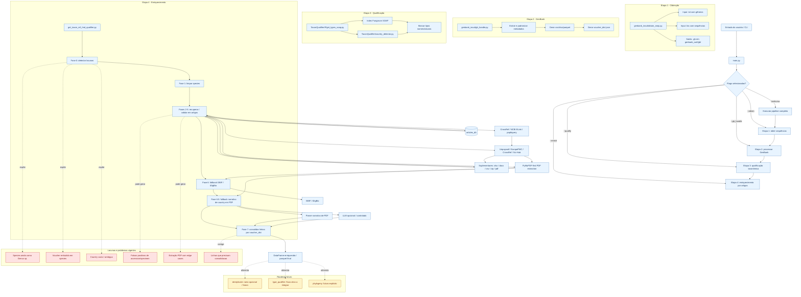

# DatasetMaker Flow Map

Documento de referência do fluxo completo do DatasetMaker para humanos e agentes de IA.

Escopo:
- Entrada e roteamento principal em `main.py`
- Etapa 1: obtenção de sequências
- Etapa 2: processamento GenBank
- Etapa 3: qualificação taxonômica
- Etapa 4: enriquecimento por artigos
- Lacunas, falhas conhecidas e roadmap futuro

## Fluxo Principal

## Leitura Rápida

- `main.py` é o roteador principal do pipeline.
- `md_qualifier.py` concentra a etapa de enriquecimento e suas fases 0-7.
- `articles_db` atua como cache/local store para evitar redownload e reprocessamento.
- `dereplicate` fica fora do caminho principal atual, mas entra como ramo futuro opcional.
- `type_qualifier` já existe como fluxo útil e deve ser integrado ao pipeline principal.
- `phylogeny` ainda está vazio e deve ser tratado como futuro explícito.

## Problemas Conhecidos

- `species` ainda pode chegar como `Genus sp.` ou com voucher embutido.
- `country` pode continuar vazio mesmo após os fallbacks.
- Há falsos positivos de accession/specimen que precisam de atenção.
- A extração de PDF depende do tipo de artigo e ainda tem edge cases.
- A consolidação por `voucher_dict` pode alterar a estrutura das linhas.

## Próximos Passos

1. Ligar este documento ao `README.md` principal.
2. Refinar os nomes dos blocos se algum módulo novo entrar no pipeline.
3. Usar este fluxo como referência para novas implementações e agentes.